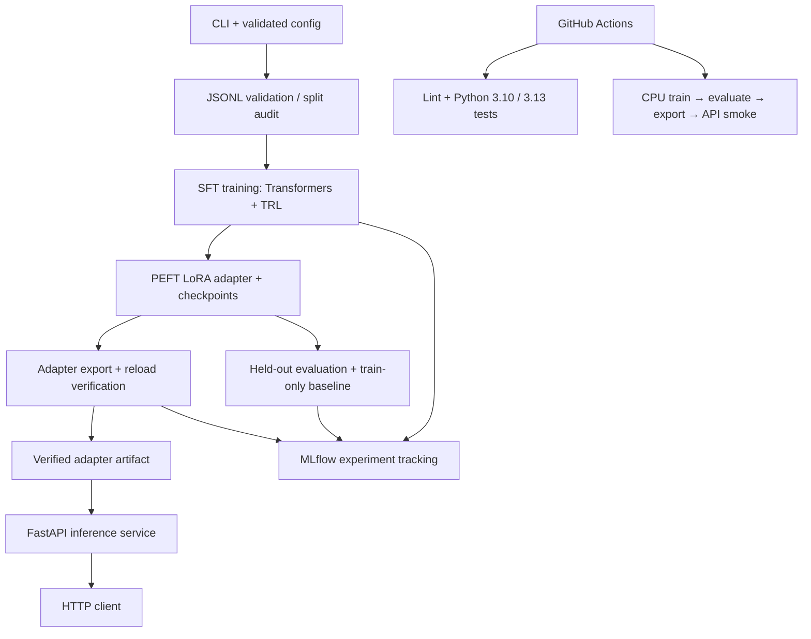

# LoRAFlow

[](https://github.com/Sujeet-Kona/LoRAFlow/actions/workflows/ci.yml)

An independently implemented, modular pipeline for preparing datasets, fine-tuning language models with LoRA, evaluating base and adapted models, exporting adapters, and serving inference APIs.

> **Status:** The pipeline runs end to end and has been verified on an Apple M4 (16 GB) with MPS and CPU. Training, evaluation, tracking, export, and serving each completed real runs whose numbers are recorded below and on disk. It is **not** production-ready: the task is a small synthetic corpus, the model is a 0.5B toy, and single-host only.

## Architecture

LoRAFlow separates offline experimentation from online inference. Dataset validation feeds the training stage; the resulting adapter is evaluated against the same held-out split, exported with reload verification, and then loaded by a FastAPI service. MLflow records experiment parameters, metrics, and artifacts without sitting in the request path.



**Key boundaries:** training and evaluation are offline commands; serving loads an existing adapter and does not train or silently fall back. Export verifies reload integrity. CI exercises a small CPU path and validates Compose configuration; it does not build an image or deploy the service. The detailed component map and lifecycle are in [Architecture](docs/architecture.md).

---

## Historical v1 measurements — not generalization evidence

**Dataset audit disclosure:** the original v1 synthetic corpus used label-correlated phrase templates. Its audit found 65–71% template overlap in held-out splits and an 82.5–85% 1-nearest-neighbour exact-match baseline. The model measurements below are retained as historical pipeline/reproducibility evidence only; they must not be presented as proof of task generalization. The v2 audit exposed a closed-vocabulary shortcut: the same symptom concepts appeared in every split. The v3 generator now holds out symptom concepts by category (three concepts per category for training, one for validation, and one for test), while severity is derived from independent systemic, functional, and trajectory attributes. The audit checks concept disjointness, category consistency, action-policy consistency, and nearest-neighbour plus per-field majority baselines. The v3 corpus has now been generated and passed the manifest-enforced local audit: 480/120/120 records, disjoint symptom concepts, no exact-note or template overlap, and all category/severity/action policy checks passed. The held-out non-neural baselines remain weak and mixed by field; this is a small synthetic concept-holdout benchmark, not evidence of broad language generalization. No v3 model-quality result is claimed until a fresh model run is evaluated against these baselines.

The figures below were printed by real v1 runs on this machine and are retained as historical artifacts:
`artifacts/{train-run,repro-run}/training_metadata.json`, `artifacts/{train-run,repro-run}/evaluation_report.json`,
and the `export_manifest.json` files under the export directories.
No external benchmark is reproduced and no accuracy is claimed beyond this synthetic task.

| Stage | Measured on this machine |
| --- | --- |
| LoRA training | `Qwen/Qwen2.5-0.5B`, rank 8 / alpha 16 on `q_proj,v_proj`; 540,672 trainable of 494,573,440 params (0.109%); 3 epochs = 90 steps; `mps` + `torch.float32`; seed 42; 413 s wall clock; `train_loss` 0.8618; best held-out `eval_loss` 0.1346336007118225 at `checkpoint-90` |
| Baseline vs fine-tuned (same 120 held-out examples) | mean answer-token loss `4.0200 → 0.1490`; perplexity `55.6996 → 1.1606`; answer-token accuracy `0.4645 → 0.9551`; exact match `0.0000 → 0.5000`; 3-token prefix match `0.0000 → 0.5000` |
| Per-field generation accuracy (24 greedy outputs) | `sev=` `0.0 → 0.875`, `cat=` `0.0 → 0.5417`, `act=` `0.0 → 0.875` |
| Adapter export | 5 adapter/tokenizer files copied, 540,672 adapter params; CI now reloads the exported adapter onto its recorded base model and runs a forward check (`Qwen2Tokenizer`, vocab 151,665, pad/eos 151,643) |
| Merged export | 494,032,768 params; `max_logit_delta` 0.000303 against tolerance 0.05, measured on a real held-out prompt before and after `merge_and_unload` |
| Serving | `/health`, `/generate`, `/metrics` verified live against the adapter on `mps`; malformed bodies rejected with 422, an over-long prompt with 400, unknown routes with 404 |
| Tracking | `loraflow mlflow-ui` serves the SQLite store; five finished runs (two `train`, three `evaluate`) listed through its REST API, with the adapter directory and each JSON report attached as an artifact |
| Tests | module-focused pytest suite; Ruff lint and format checks |
| CPU path | `configs/ci_smoke.yaml` on `sshleifer/tiny-gpt2`: `cpu` + `torch.float32`, 2 steps, `train_loss` 10.83, accuracy deltas `+0.0000` — plumbing verified, learning is not the point of that config |

**Historical v1 provenance.** The figures above were produced before the v1 dataset leakage was identified; they remain reproducible pipeline records, not valid evidence of generalization. The 90-step
run was repeated into a second output directory (`configs/repro_check.yaml` → `artifacts/repro-run/`)
and the two runs agree exactly: `best_eval_loss` `0.1346336007118225`, `train_loss` `0.8617594838142395`,
`checkpoint-90` as the best checkpoint, a byte-identical `adapter_model.safetensors`
(sha256 `2652b6c2bb83f259…e2bf5d` for both), and an evaluation report whose `baseline`, `fine_tuned`,
`delta` and `field_accuracy` blocks compare equal. Only wall clock differed (`413.23 s` vs `342.01 s`).
The adapter and merged exports were then re-run from that second adapter into
`artifacts/repro-exported` and `artifacts/repro-merged`: same 540,672 adapter params in 5 files, same
494,032,768 merged params, same `max_logit_delta` `0.000303` against tolerance `0.05`, both exit 0.
Serving and the MLflow UI were checked against the current tree too. No external benchmark is
reproduced anywhere in this table.

## V4 controlled benchmark (current experiment)

V4 is a separate, controlled synthetic benchmark under `data/v4/`; it does not overwrite the historical v1-v3 corpora. It contains three tracks, each with 600 training, 120 validation, and 150 held-out test examples:

| Track | Intended distribution shift |
| --- | --- |
| A | Unseen symptom concepts; shared severity wording |
| B | Shared symptom concepts; unseen severity wording |
| C | Both symptom concepts and severity wording are held out |

The generator uses deterministic seeds, eight concepts per category, exact severity quotas, split manifests and SHA-256 hashes. It removes random animal IDs and runs allocation, uniqueness, token-length and policy checks before writing. The TF-IDF + LinearSVC baseline is fit on training text only; it does not fit on test examples. Its action field is derived from predicted severity using the benchmark's deterministic policy, so action is not an independent classification result.

The experiment uses `Qwen/Qwen2.5-0.5B` with standard LoRA (rank 8, alpha 16, dropout 0.05, `q_proj` and `v_proj`). Each adapter has 540,672 trainable parameters (about 0.109% of 494,573,440 base parameters). Three training and evaluation runs completed locally; all three adapters were exported and reload-verified. All three Prompt-v2 adapters were loaded sequentially into the FastAPI service on Apple MPS and exercised through `/health` and `/generate`; each returned a schema-valid completion with `adapter_applied: true`. This verifies the tested local serving path, not a production deployment.

### Prompt-v2 held-out results

The prompt-v2 rerun has now completed for all three tracks. Each result below is measured on the same track's 150-example held-out test split. The primary comparison is against the train-only TF-IDF + LinearSVC baseline; the unadapted Qwen baseline emits prose that often violates the required one-line schema, so its zero exact-match score is **not** evidence that the adapter beats a capable base-model classifier.

| Track | LoRA exact match | TF-IDF + LinearSVC exact match | Strict structured-output validity | Category macro-F1 |
| --- | ---: | ---: | ---: | ---: |
| A | 68.00% | 30.00% | 100.00% | 0.7004 |
| B | **77.33%** | 56.00% | 98.67% | **0.8606** |
| C | 37.33% | 16.67% | 100.00% | 0.4345 |

Track B is the strongest prompt-v2 result. Track C shows a substantial category-generalization weakness and should not be presented as a strong classifier. Track A's nearest-neighbour audit found 11 of 60 sampled test notes (18.33%) with Jaccard similarity of at least 0.9 to a training note; exact duplicates were zero, but this weakens the claim that Track A is a clean unseen-concept test. Tracks B and C had zero such cases in the 60-note audit sample. Full field metrics, per-class results, split hashes, MLflow run IDs, and limitations are documented in [the prompt-v2 results report](docs/prompt-v2-results.md).

These are controlled synthetic-task measurements, not evidence of veterinary utility, clinical safety, or broad natural-language generalization. The unadapted base-model exact-match score is format-confounded and must not be used as the headline improvement claim. Action is deterministically derived from severity and is not an independent prediction task.

The benchmark is an engineering fixture for testing controlled distribution shifts and the fine-tuning/evaluation pipeline. It is not veterinary guidance or a clinical decision system.

The exact Prompt-v2 JSONL inputs, manifests, and configs are committed. To reproduce the three runs from a **fresh checkout** (requires the `train`, `serve`, and `dev` extras plus a Hugging Face model download), run:

```bash
pip install -e ".[train,serve,dev]"
bash scripts/run_prompt_v2_experiments.sh
```

The runner verifies split hashes/counts before training, then evaluates, exports/reload-validates, and smoke-tests all three adapters. It refuses to overwrite existing run/export directories. See [the detailed report](docs/prompt-v2-results.md) for protocol, caveats, and measured results.

## Quickstart

```bash
python -m venv .venv && source .venv/bin/activate
pip install -e ".[dev]"            # core logic and tests, no torch needed
pip install -e ".[train,serve]"    # ML stages
```

```bash
python scripts/make_dataset.py                 # writes isolated v3 data to data/v3/; preserves v1 and v2
loraflow data-check --config configs/train.yaml
loraflow train      --config configs/train.yaml
loraflow evaluate   --config configs/train.yaml
loraflow export     --config configs/train.yaml              # adapter + tokenizer; refuses to replace an existing export
loraflow export     --config configs/train.yaml --overwrite  # explicitly replace the adapter export
loraflow export     --config configs/train.yaml --merged --overwrite  # replace merged standalone export
loraflow serve      --config configs/train.yaml --port 8125
loraflow mlflow-ui                                             # tracked runs and metrics
pytest
```

Three configs sit alongside the main one:

- `configs/smoke.yaml` — 2 optimizer steps on the real model, MPS, no tracking.
- `configs/ci_smoke.yaml` — `sshleifer/tiny-gpt2` on CPU, 2 steps, 24 examples, tracking off; this is what CI runs.
- `configs/repro_check.yaml` — identical to `train.yaml` except the output directories; used for the
  repeat run behind the reproducibility claim above.

## Scope

LoRAFlow follows a practical fine-tuning lifecycle:

1. Validate and prepare instruction datasets.
2. Configure a base model and LoRA adapter.
3. Run supervised fine-tuning with Hugging Face tooling.
4. Evaluate the base and adapted models on the same held-out examples.
5. Save and optionally merge/export adapters.
6. Serve inference through a lightweight FastAPI application.
7. Track experiments and expose basic operational metrics.

## Deliberate exclusions

- Kubernetes and cluster orchestration
- vLLM serving

## Repository layout

```text
LoRAFlow/
├── .github/workflows/ci.yml     lint -> unit matrix -> full pipeline smoke
├── configs/
│   ├── default.yaml             every supported key, commented
│   ├── train.yaml               the verified 0.5B run
│   ├── repro_check.yaml         that run again, into a second output directory
│   ├── smoke.yaml               2-step MPS validation
│   └── ci_smoke.yaml            tiny-gpt2 / CPU / 2 steps, tracking off
├── scripts/make_dataset.py      compositional synthetic v3 corpus generator with concept holdouts
├── src/loraflow/
│   ├── config.py                pydantic model, extra="forbid"
│   ├── runtime.py               device/dtype resolution, seeding, JSON helpers
│   ├── data.py                  JSONL loading, prompt templating, splitting  (torch-free)
│   ├── metrics.py               normalization, exact/prefix/field, perplexity (torch-free)
│   ├── training.py              LoRA/TRL SFT stage, checkpoints, metadata
│   ├── evaluation.py            teacher-forced + greedy comparison
│   ├── tracking.py              MLflow tracker plus a no-op fallback
│   ├── export.py                adapter export, merged export with logit check
│   ├── api.py                   FastAPI app, Prometheus metrics, model service
│   └── cli.py                   data-check | train | evaluate | export | serve | mlflow-ui
├── tests/                       module-focused unit and integration tests
├── Dockerfile / docker-compose.yml
└── pyproject.toml
```

Heavy imports (`torch`, `transformers`, `trl`, `peft`) live inside the ML modules, so
`pip install -e ".[dev]"` alone runs the data, metrics, config, and CLI test suites.

## Synthetic task and dataset controls

`scripts/make_dataset.py` generates a synthetic animal-observation triage task. Each record
contains a free-text observation and a three-field target (`sev=… cat=… act=…`). Category
comes from the symptom concept. Severity is derived from independently sampled systemic,
functional, and trajectory attributes using an explicit policy function; action follows the
severity-to-action mapping. The labels are therefore not selected first and then encoded in a
single severity phrase.

The generator writes v3 data to `data/v3/` by default, preserving the original v1 and v2
files for audit/reproduction. Each category has five symptom concepts: three are available
only to training, one only to validation, and one only to test. This is a concept-held-out
benchmark, not merely a sentence-template split. A generated `manifest.json` records the
concept allocation and policy. Run `scripts/audit_dataset.py` with
`--manifest data/v3/manifest.json` to enforce concept disjointness, category-to-concept
consistency, severity-policy consistency from the visible scenario cues, action-to-severity
consistency, and to report 1-nearest-neighbour and per-field
majority baselines. Severity is derived from independently sampled systemic, functional, and
trajectory attributes; action follows the explicit severity policy. The corpus remains a
synthetic engineering fixture, not veterinary guidance or a clinical decision system. Five
concepts per category and one held-out concept per category are still a small benchmark;
passing this audit does not establish broad natural-language generalization. No v3 model-quality
claim is made until the generated corpus is audited and evaluated against the reported
non-neural baselines.

Use real instruction-tuning JSONL with the configured instruction and output fields, plus an
optional input field. Plain-text-only records are not supported for supervised instruction tuning.

## Configuration

`configs/default.yaml` documents every key. The ones that change behaviour:

- `data.prompt_template` — `{instruction}` plus `{input_block}`, which expands to an
  `### Input:` section only when a record carries an input value; `validation_size` carves a
  seeded split when no `validation_file` is given; `max_train_examples` caps the corpus.
- `training.device` / `training.dtype` — `auto` resolves CUDA → MPS → CPU and picks bf16 on CUDA,
  fp32 otherwise. An explicitly requested but unavailable device raises instead of silently moving.
- `training.warmup_steps`, `lr_scheduler`, `weight_decay`, `eval_steps`, `save_steps`,
  `gradient_checkpointing`, `max_steps`, `seed`, `run_name`.
- `evaluation.*` — `max_examples` (teacher-forced scoring), `generation_examples` (greedy decoding),
  `max_new_tokens`, `batch_size`; both models score the *same* held-out list.
- `tracking.*` — `sqlite:///mlflow.db` by default because MLflow 3.x keeps the plain filesystem
  store in maintenance mode; artifacts go to `artifacts_dir`.
- `export.*` — `output_dir`, `merged_dir`, `merge_and_save`, `save_dtype`, `verify_reload`. Adapter export reloads the adapter on its recorded base model and runs a forward check when `verify_reload: true`; merged export always performs its adapter-vs-merged logit check.
- `serving.*` — `host`, `port`, `device`, `max_new_tokens`, `max_input_chars`,
  `max_concurrent_requests`, `log_level`.

## Inference API

`loraflow serve` loads the configured base model, applies the adapter when the directory exists,
and reports the result through `/health` (200 `ok`, 503 `degraded` while a load error is pending).

```bash
curl -s localhost:8125/generate -H 'content-type: application/json' -d '{
  "prompt": "Read the barn health note and label it with severity, category and action. Reply with exactly one line in the form sev=<severity> cat=<category> act=<action>. Use only the codes defined by the triage table.",
  "input": "Animal A213: lost hair along the left flank. Moving normally, with no other change today.",
  "max_new_tokens": 24
}'
# {"completion":"sev=routine cat=skin act=log_only", "completion_line":"sev=routine cat=skin act=log_only",
#  "prompt_tokens":78, "completion_tokens":11, "adapter_applied":true, "elapsed_seconds":0.3411}
```

`prompt` maps to the instruction field and `input` to the input field, so a request reproduces the
exact prompt the adapter was trained on (`format_prompt: false` sends raw text instead). Responses
carry both `completion` and `completion_line`. Send the training instruction verbatim: an off-distribution
instruction ("Triage this calf observation note.") was measured to return chat prose instead of the
`key=value` line, which is the adapter doing exactly what it was trained to do and nothing more.

To smoke-test all three exported Prompt-v2 adapters sequentially (without Docker), run this after the
local Prompt-v2 artifacts are present:

```bash
bash scripts/smoke_prompt_v2_serving.sh
```

The script checks `/health`, confirms `adapter_applied: true`, and rejects a generated response that
does not match the exact benchmark label schema. The Prompt-v2 smoke script passed locally for all three exported adapters: each health check
returned `ok`, each service reported `adapter_applied: true`, and each generated a schema-valid
completion. This verifies the tested local serving path; it is not a production deployment claim.

Out-of-range bodies become 422 before any tensor is allocated (verified: empty `prompt`), an over-long
prompt becomes 400 with the limit named (verified: 5,046 characters against `max_input_chars: 4000`),
an unknown route becomes 404, and a model that failed to load becomes 503 with the reason rather than a
silent fallback. `/metrics` exposes `loraflow_requests_total`, `loraflow_generation_seconds`,
`loraflow_requests_in_flight`, and `loraflow_model_loaded`.

## Experiments

`train` and `evaluate` log the flattened config, LoRA hyperparameters, split statistics, step and
epoch counts, losses, the comparison deltas, and the artifact paths to MLflow, then attach
`training_metadata.json` / `evaluation_report.json` as artifacts. `loraflow mlflow-ui` opens the
local UI. `--no-track` (or `tracking.enabled: false`) swaps in a no-op tracker, and a missing MLflow
install logs a warning and degrades to no-op rather than failing the run.

The recorded experiment holds five finished runs: two training runs (61 params and 28 metrics each,
`train_loss` 0.8618, `best_eval_loss` 0.1346, artifacts `adapter/` + `training_metadata.json`) and three
evaluation runs (33 params and 36 `eval.*` metrics covering both models on the same 120 examples,
artifact `evaluation_report.json`). The default `tracking_uri` is a SQLite store because MLflow's `ui`
command takes `--backend-store-uri`, not `--tracking-uri` — the CLI passes the right one.

## Tests

`pytest` runs the module-focused test suite across the core, ML integration, export, API, and CLI modules. Coverage: JSONL validation with the offending line
number, template rendering (empty input blocks, custom templates, whitespace-terminated templates,
unknown placeholders), seeded split determinism and disjointness, generator severity-policy rules and split-family isolation, deduplication, split statistics,
device and dtype resolution including the unavailable-accelerator error, seeding, atomic JSON writes,
answer normalization, exact/prefix/per-field scoring, perplexity, masked token accuracy, delta
formatting, prompt/completion column shape, LoRA and `SFTConfig` translation (including
`completion_only_loss` and holding CUDA-only precision flags off the MPS path), best-checkpoint
selection, adapter parameter counting, answer-label masking and input-block recovery in evaluation,
export file/zero-byte/unknown-kind rejection, real adapter reload validation, explicit overwrite safety, and the logit-delta helper used by the merge check, every
API route including the 400/404/422/500/503 paths, and the CLI parser, its exit codes, and the
argument list `mlflow-ui` hands to MLflow's server.

Export destinations are not removed implicitly: if the destination already exists, the command fails without changing it. Use `loraflow export --overwrite` only when replacing that directory is intentional. Model-dependent suites gate on `pytest.importorskip`, so the core logic proves out without torch. The
actual base-versus-adapter comparison needs weights, so it is exercised by the CI pipeline job on
`sshleifer/tiny-gpt2` and by the recorded MPS run rather than as a unit test.

```bash
pytest                                        # everything installed
pytest tests/test_data.py tests/test_metrics.py  # core logic only
ruff check src tests scripts && ruff format --check src tests scripts
```

## Containers and CI

`docker build -t loraflow .` installs the CPU torch wheel on `python:3.11-slim`, then
`.[train,serve]`; the image health-checks `/health` and defaults to `loraflow serve`.
`docker compose up api` starts the server, `docker compose run --rm train` (profile `pipeline`, which
also covers `evaluate` and `export`) runs the stages against `configs/train.yaml` — that is the real
0.5B job, not a smoke test — and profile `tracking` adds an `mlflow/mlflow:3.18.0` UI pointed at the
same SQLite store and artifact directory the pipeline writes.

GitHub Actions runs lint, then the pure-logic suite on Python 3.10 and 3.13 with a dev-only install,
then a full pipeline job on the tiny model: dataset build, `data-check`, 2-step `train` with
artifact existence assertions, `evaluate` with report-completeness assertions, `export`, and a live
`serve` check that curls `/health`, `/generate`, `/metrics` and asserts the 422 path.

**Verification status of this section:** Docker is not installed on the development machine, so the
image was never built and the compose stack never started. CI validates the Compose configuration
syntax, but the image build and live container stack remain unverified. CI is configured to run the
full smoke pipeline; a completed green hosted run is required before claiming that path is verified.
Every command the pipeline job runs *was* executed locally from the current tree, in order, against
`configs/ci_smoke.yaml`: `make_dataset.py` (regenerated both files with byte-identical sha256 sums),
`data-check`, `train`, `evaluate`, and `export` — all exit 0, with `training_metadata.json`,
`evaluation_report.json` and `exported/adapter/export_manifest.json` on disk. On that config the tiny
random-init model is the point, not the accuracy: 2 steps on CPU, `train_loss` 10.83, and deltas of
`-0.0000` loss / `+0.0000` accuracy. The pipeline job proves plumbing; `configs/train.yaml` proves
learning.

## Hardware notes

Verified on an Apple M4 MacBook Air with 16 GB RAM, no CUDA. torch 2.15.0 MPS was checked directly
(matmul and bf16 both work) but training runs in fp32 on the Mac path, because bf16/fp16 training
coverage on MPS is not something to assume. The recorded 0.5B run completed in 413 s wall clock on a
single device and its merged export is a 1,976,163,472-byte `model.safetensors`. **QLoRA is not
implemented in this release**; the verified training path is standard LoRA. A separate CUDA-specific
quantized loading, training, and export path would be required before claiming QLoRA support.

## Known limitations

- Results come from a small synthetic task and a 0.5B model; they demonstrate the pipeline, not
  real-world quality. No public benchmark is reproduced.
- Training is single-process and single-device. `gradient_accumulation_steps` is the only
  parallelism knob; there is no FSDP, DeepSpeed, or multi-node support by design.
- Evaluation reports teacher-forced answer-token loss/accuracy and generated exact/prefix match,
  per-field macro-F1, per-class precision/recall, confusion matrices, and strict structured-output
  validity. These remain automatic synthetic-task metrics: there is no human evaluation, semantic
  equivalence assessment, or calibration metric.
- The serving app holds one model per process with a bounded semaphore (`max_concurrent_requests`);
  it is a correctness-checked single-host server, not a throughput-tuned one. No auth, no rate
  limiting, no request queueing beyond the semaphore.
- MLflow tracking writes to a local SQLite store; the artifact location of an existing experiment is
  honoured rather than rewritten, so a pre-existing `loraflow` experiment keeps its original location
  and logs a warning.
- Merging is verified for bf16/fp32 saves. Lower-precision `save_dtype` values widen the tolerance to
  0.25 instead of proving equivalence.
- The container path is unverified: no Docker engine was available on the development machine, so
  `Dockerfile` and `docker-compose.yml` are reviewed configuration rather than tested artifacts.

## Reference

The high-level workflow was informed by the public project [Rishi625/LLM-Finetune-Pipeline](https://github.com/Rishi625/LLM-Finetune-Pipeline). LoRAFlow is a separate implementation; no source files are copied from that repository.
