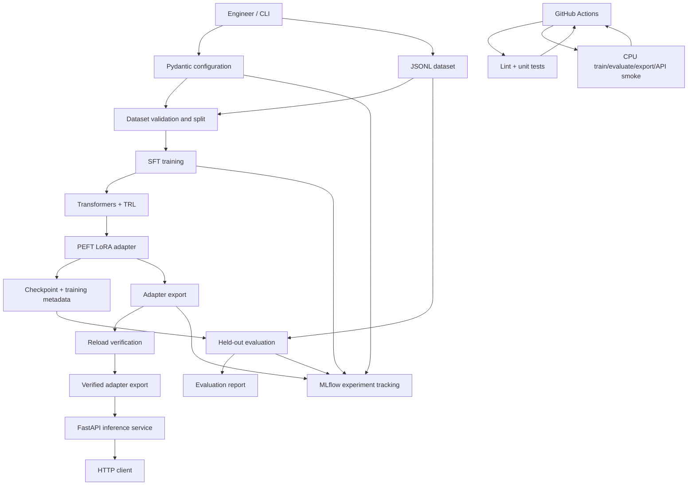

# LoRAFlow Architecture

LoRAFlow is a single-host, modular fine-tuning workflow. Its boundaries are explicit: dataset validation, model training, evaluation, artifact export, inference serving, and experiment tracking are separate stages. The CLI coordinates offline work; the API serves an already-trained artifact and never starts training during a request.

## System architecture

## Component ownership

| Component | Responsibility | Important boundary |
|---|---|---|
| `config.py` | Parse and validate the experiment configuration | Reject unknown or invalid settings before work starts |
| `data.py`, `audit.py`, `baselines.py` | Load JSONL, construct prompts/splits, audit leakage, and compute non-neural baselines | Training and evaluation consume explicit split files; held-out examples are not used to fit baselines |
| `training.py` | Configure the base model, tokenizer, LoRA adapter, optimizer, and supervised fine-tuning loop | Training is an offline command, not an API responsibility |
| `evaluation.py`, `metrics.py` | Compare base and adapted models on the same held-out records | Report exact match, field-level and token-level metrics with task-specific caveats |
| `export.py` | Export adapter/tokenizer artifacts and optionally merge weights | Adapter reload and merged-logit checks validate artifact integrity |
| `api.py` | Load an exported adapter and expose inference, health, and operational metrics | A failed model load is visible; the service does not silently substitute a different model |
| `tracking.py` | Record configuration, metrics, run metadata, and artifacts in MLflow | Tracking is an experiment record, not a model registry or deployment control plane |
| `cli.py` | Coordinate data-check, train, evaluate, export, serve, and tracking commands | Each stage can be run and inspected independently |

## Experiment lifecycle

1. **Validate inputs.** Parse the configuration, validate JSONL fields, render prompts, and verify the dataset/split manifest.
2. **Train.** Load the configured base model and apply PEFT LoRA modules. Save checkpoints and training metadata.
3. **Evaluate.** Score the base and adapted models on the same held-out examples. Compare with a baseline fitted only on training data.
4. **Export.** Save the adapter and tokenizer. Reload the saved artifact against its recorded base model and run a forward-pass check. Optional merged exports receive a logit-equivalence check.
5. **Serve.** Load a selected artifact into FastAPI. The service validates request size and schema, performs generation, and exposes health and request metrics.
6. **Track.** Record parameters, metrics, run metadata, and artifact references in MLflow throughout the offline lifecycle.

## Quality gates

The GitHub Actions workflow runs Ruff lint and formatting checks, unit tests across Python 3.10 and 3.13, and a CPU smoke pipeline. The smoke pipeline validates a small training run, evaluation, export, adapter reload, API request, and Docker Compose configuration. It does not build a Docker image, deploy the service, or establish production readiness.

## Benchmark interpretation

LoRAFlow includes controlled synthetic benchmarks with explicit distribution shifts. These are useful for testing whether the pipeline detects leakage, compares models consistently, exports artifacts, and serves structured outputs. They are not evidence of broad natural-language generalization or domain safety. Track-level metrics and known weaknesses are documented in [Prompt-v2 results](prompt-v2-results.md) and [V4 benchmark protocol](v4-controlled-benchmarks.md).

## Repository map

- `src/loraflow/`: reusable pipeline modules and CLI
- `configs/`: strict, versioned experiment configurations
- `data/`: committed benchmark inputs and split manifests
- `scripts/`: dataset generation, audits, reproducible experiment runners, and serving smoke tests
- `tests/`: unit and integration coverage
- `artifacts/`: local run outputs; generated model weights are not required in a fresh clone
- `.github/workflows/ci.yml`: automated quality gates
